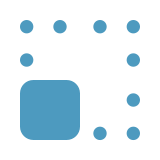
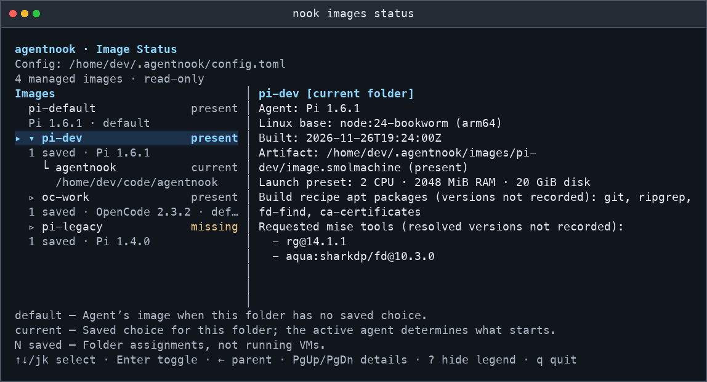

<p align="center">
  
</p>

# agentnook

Eine eigene Ecke für deinen Coding-Agenten. `nook` startet **Pi**, **OpenCode v2** oder **Claude Code** in einer kurzlebigen [smolvm](https://github.com/smol-machines/smolvm)-VM. Logins, Einstellungen, Skills und Erweiterungen bleiben erhalten.

## Schnellstart

Voraussetzungen: macOS mit Apple Silicon oder Linux mit KVM; **smolvm ≥ 1.36.1** im `PATH`.

```sh
curl -qfsS https://raw.githubusercontent.com/flobilosaurus/agentnook/main/install.sh | sh
```

Danach `nook` im Projektordner starten.

## Wichtige Befehle

| Befehl | Zweck |
| --- | --- |
| `nook --select` | Agent oder Profil wechseln |
| `nook -- --continue` | Argumente an den Agenten weitergeben |
| `nook --mount ../lib:/mnt/lib:ro` | Zusätzlichen Ordner schreibgeschützt freigeben |
| `nook images` | Lokale Images anzeigen |
| `nook images status` | Aufbau der Images und Toollisten anzeigen |
| `nook watch` | Laufende VMs projektübergreifend anzeigen |
| `nook network` | Netzwerkhistorie und offene TCP-Freigaben anzeigen |
| `nook --help-all` | Alle Optionen anzeigen |

## Images und Tools

`nook images build` installiert zusätzliche Tools mit [mise](https://mise.jdx.dev/) fest ins Image.

**`--tool NAME@VERSION`** gibt ein Tool direkt an. Wiederhole das Flag für weitere Tools:

```sh
nook images build pi-dev --agent pi --tool rg@14.1.1 --tool fd@10.3.0
```

**`--mise-config PFAD`** übernimmt `[tools]` aus einer mise-TOML-Datei, ohne Tasks oder Hooks auszuführen:

```sh
nook images build pi-dev --agent pi --mise-config ./mise.toml
```

Beide Flags lassen sich kombinieren.

`nook images status` zeigt die Images, ihre Tools und die gespeicherten Projektzuordnungen, ohne eine VM zu starten.



## Einstellungen / Skills / Erweiterungen des Agenten bearbeiten

Ein **Profil** wie `arbeit` oder `privat` speichert Logins, Einstellungen, Skills und Erweiterungen pro Agent. Die Daten bleiben nach VM-Ende erhalten und werden in allen Projekten mit demselben Profil und Agenten wiederverwendet.

Auf dem Host: `~/.agentnook/profiles/<profil>/<agent>/`. Ist `AGENTNOOK_HOME` gesetzt, liegt `profiles/` dort. In der VM ist der jeweilige Agentenordner das Home-Verzeichnis (`~`).

**Einstellungen und Skills:** Änderst du in einer Pi-VM Einstellungen oder fügst einen Skill im Profil `arbeit` hinzu, nutzen andere Pi-Sessions mit `arbeit` dieselben Dateien. In bereits laufenden Sessions lädt `/reload` die Änderungen ein; neue Pi-Starts lesen sie automatisch. Manche Einstellungen, etwa der Standard-Denkmodus, greifen erst beim Start. Andere Profile bleiben unverändert.

| Agent | Einstellungsdatei in der VM | Skill-Ordner in der VM |
| --- | --- | --- |
| Pi | `~/.pi/agent/settings.json` | `~/.pi/agent/skills/` |
| OpenCode v2 | `~/.config/opencode/opencode.json` | `~/.config/opencode/skills/` |
| Claude Code | `~/.claude/settings.json` | `~/.claude/skills/` |

**Erweiterungen installieren:** Platzhalter durch Paket- oder Plugin-Namen ersetzen:

```sh
nook --agent pi --profile arbeit -- install npm:PAKETNAME </dev/null
nook --agent opencode --profile arbeit -- plugin add PAKETNAME
nook --agent claude --profile arbeit -- plugin install PLUGIN@MARKETPLACE --scope user
```

Lokale Erweiterungen gehören bei Pi nach `~/.pi/agent/extensions/`, bei OpenCode nach `~/.config/opencode/plugins/` (VM-Pfade). Danach Agent neu starten.

## Einblicke ins Terminal

### `nook watch`

`nook watch` zeigt laufende Agenten-VMs über alle Projekte hinweg, gruppiert nach Profil.


### Herdr

Startest du `nook` interaktiv in einem [Herdr](https://herdr.dev/)-Pane, meldet es den Status von Pi, OpenCode v2 oder Claude Code automatisch an dieses Pane. So siehst du in Herdr, welcher Agent arbeitet (`working`), bereit ist (`idle`) oder auf deine Eingabe wartet (`blocked`), ohne zum jeweiligen Tab wechseln zu müssen.

Herdr kann aus Statuswechseln in Hintergrund-Tabs Benachrichtigungen erzeugen: **Braucht Aufmerksamkeit** beim Wechsel zu `blocked`, **Fertig** beim Wechsel von `working` oder `blocked` zu `idle`.

### `nook network`

Mit `nook network` entscheidest du im Modus `--network ask`, welche ausgehenden TCP-Verbindungen der Agent aufbauen darf. Im Audit siehst du gespeicherte Netzwerkentscheidungen auch nach Ende der VM: erlaubte und blockierte Zugriffe in `ask`, nur blockierte in `full`.


Im Audit siehst du gespeicherte Netzwerkentscheidungen auch nach Ende der VM: erlaubte und blockierte Zugriffe in ask, nur blockierte in full.


