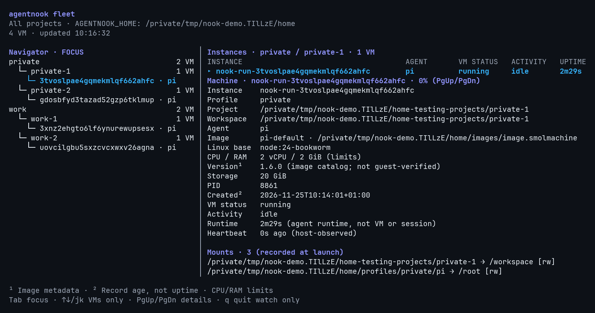
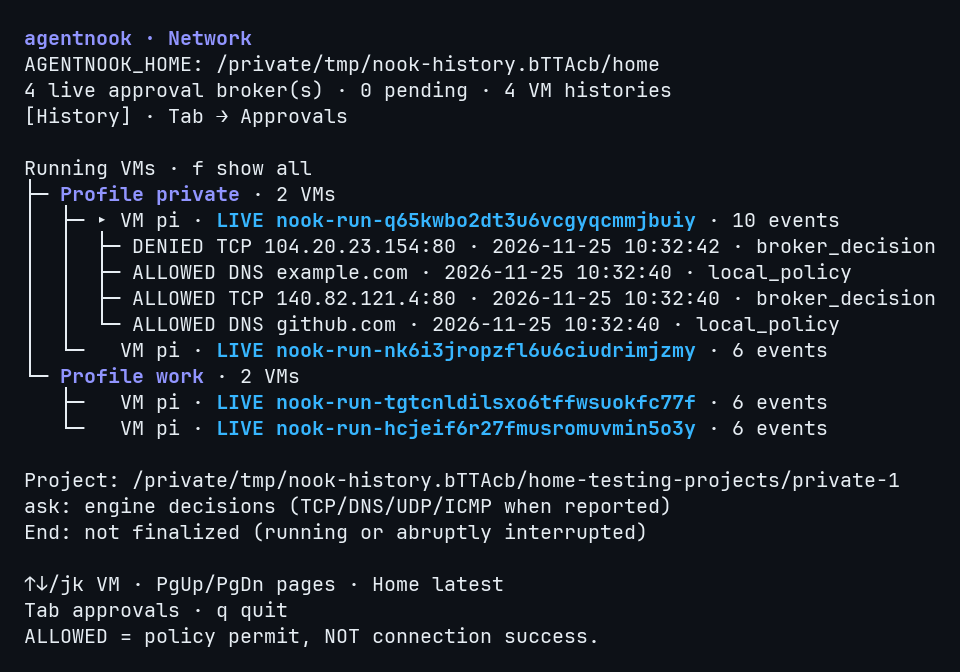

<p align="center">
  
</p>

# agentnook

Eine eigene Ecke für deinen Coding-Agenten. `nook` startet **Pi**, **OpenCode v2** oder **Claude Code** in einer kurzlebigen [smolvm](https://github.com/smol-machines/smolvm)-VM. Profile und Logins bleiben erhalten.

## Schnellstart

Voraussetzungen: macOS mit Apple Silicon oder Linux mit KVM; **smolvm ≥ 1.36.1** im `PATH`. Docker, Node.js und der Agent sind auf dem Host nicht nötig.

```sh
curl -qfsS https://raw.githubusercontent.com/flobilosaurus/agentnook/main/install.sh | sh
export PATH="$HOME/.local/bin:$PATH"
cd /pfad/zum/projekt
nook
```

Beim ersten Start Agent und Profil wählen, danach im Agenten anmelden. `nook` baut das Image lokal und merkt sich die Auswahl pro Projektordner. Weitere Starts brauchen nur `nook`.

## Wichtige Befehle

| Befehl | Zweck |
| --- | --- |
| `nook --select` | Agent oder Profil wechseln |
| `nook -- --continue` | Argumente an den Agenten weitergeben |
| `nook --mount ../lib:/mnt/lib:ro` | Zusätzlichen Ordner schreibgeschützt freigeben |
| `nook images` | Lokale Images anzeigen |
| `nook watch` | Laufende VMs projektübergreifend anzeigen |
| `nook network` | Netzwerkhistorie und offene TCP-Freigaben anzeigen |
| `nook --help-all` | Alle Optionen anzeigen |

## Einblicke ins Terminal

### `nook watch`

Vier laufende Pi-VMs in zwei Profilen. Links steht die Projektübersicht, rechts die ausgewählte VM mit Status, Ressourcen und Mounts.



### `nook network`

Zwei offene TCP-Anfragen im Modus `--network ask`. Für die ausgewählte Anfrage zeigt die Ansicht Ziel-IP, Port und den ungeprüften HTTP-Hostnamen.


Mit `Tab` wechselst du zur Historie. Sie zeigt die protokollierten Netzentscheidungen pro VM. `ALLOWED` bedeutet, dass die Richtlinie den Zugriff erlaubt hat, nicht dass die Verbindung erfolgreich war.



## Grenzen der Isolation

Projektordner und ausgewähltes Agenten-HOME sind beschreibbar. Änderungen dort und an weiteren beschreibbaren Freigaben bleiben bestehen. Der Agent hat Zugriff auf die Logins seines Profils. Teile Profile daher nur zwischen vertrauenswürdigen Projekten.

Öffentliche Internetziele sind standardmäßig erreichbar; Netzwerkzugriffe auf Host und private Netze sind gesperrt. Mit `nook --network ask` lassen sich ausgehende TCP-Verbindungen in `nook network` freigeben. HTTP-Hostnamen können als ungeprüfte Hinweise erscheinen; freigegeben wird nach IP und Port. DNS erfordert keine Freigabe.

## Mehr dazu

- [Benutzung](docs/benutzung.md): Installation aus Quellcode, Images, Profile, Netzwerk und Herdr
- [Entwicklung](docs/entwicklung.md): Checks, CI, Releases und manuelle Herdr-Testsession
- [Logo und Lizenz](docs/design/logo/README.md) · [Drittlizenzen](THIRD_PARTY_NOTICES.md)

Im Release-Archiv fehlt der Ordner `docs/`; die Dokumentation steht im [GitHub-Repository](https://github.com/flobilosaurus/agentnook).
