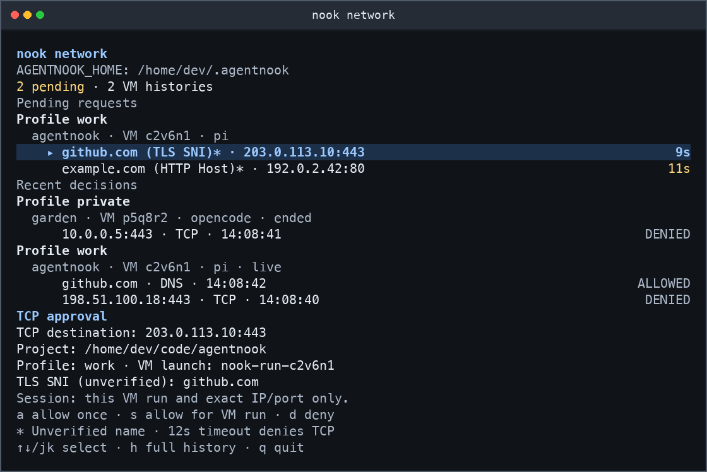

<p align="center">
  
</p>

# agentnook

Eine eigene Ecke für deinen Coding-Agenten. `nook` startet **Pi**, **OpenCode v2** oder **Claude Code** in einer kurzlebigen [smolvm](https://github.com/smol-machines/smolvm)-VM. Logins, Einstellungen, Skills und Erweiterungen bleiben erhalten.

## Schnellstart

Voraussetzungen: macOS mit Apple Silicon oder Linux mit KVM; **smolvm ≥ 1.36.1** im `PATH`.

```sh
curl -qfsS https://raw.githubusercontent.com/flobilosaurus/agentnook/main/install.sh | sh
```

Danach `nook` im Projektordner starten.

## Wichtige Befehle

| Befehl | Zweck |
| --- | --- |
| `nook --select` | Agent oder Profil wechseln |
| `nook -- --continue` | Argumente an den Agenten weitergeben |
| `nook --mount ../lib:/mnt/lib:ro` | Zusätzlichen Ordner schreibgeschützt freigeben |
| `nook images` | Lokale Images anzeigen |
| `nook watch` | Laufende VMs projektübergreifend anzeigen |
| `nook network` | Netzwerkhistorie und offene TCP-Freigaben anzeigen |
| `nook --help-all` | Alle Optionen anzeigen |

## Einblicke ins Terminal

### `nook watch`

`nook watch` zeigt laufende Agenten-VMs über alle Projekte hinweg, gruppiert nach Profil.


### `nook network`

Mit `nook network` entscheidest du im Modus `--network ask`, welche ausgehenden TCP-Verbindungen der Agent aufbauen darf. Im Audit siehst du gespeicherte Netzwerkentscheidungen auch nach Ende der VM: erlaubte und blockierte Zugriffe in `ask`, nur blockierte in `full`.



Im Audit siehst du gespeicherte Netzwerkentscheidungen auch nach Ende der VM: erlaubte und blockierte Zugriffe in ask, nur blockierte in full.


